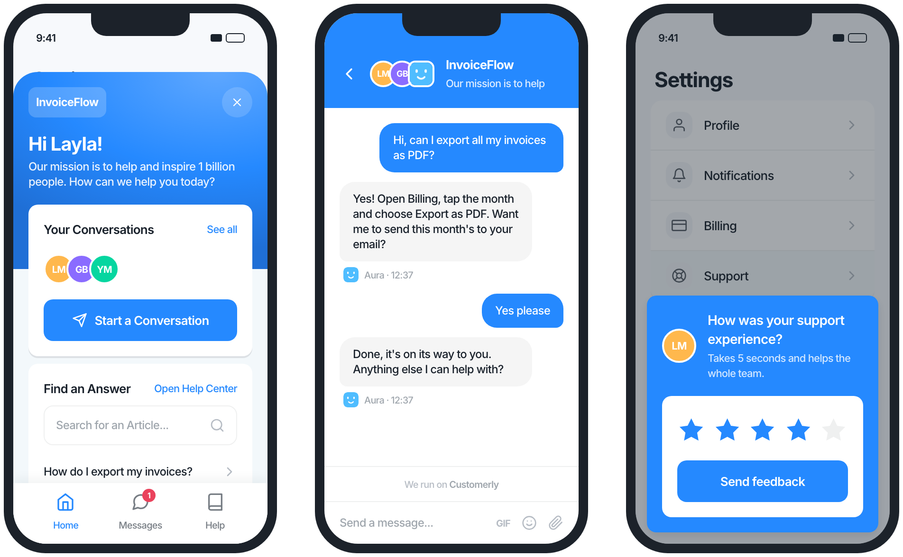

<a href="https://www.customerly.io?utm_source=github&utm_medium=readme&utm_campaign=android-sdk" target="_blank">
    
</a>

# Customerly Android SDK

[](https://central.sonatype.com/artifact/io.customerly/customerlyandroidsdk)


[](https://www.customerly.io/mobile-sdk/?utm_source=github&utm_medium=readme&utm_campaign=android-sdk)

<p align="center">
  <a href="https://www.customerly.io/mobile-sdk/?utm_source=github&utm_medium=readme&utm_campaign=android-sdk">
    
  </a>
  <br>
  <sub>What your users see: the messenger home, a conversation with Aura, and an in-app survey. Illustration with a fictional app.</sub>
</p>

## Support, onboard and retain your Android users — with AI

The Customerly Android SDK brings the full [Customerly customer interaction platform](https://www.customerly.io/customer-interaction-platform/?utm_source=github&utm_medium=readme&utm_campaign=android-sdk) inside your app in a few lines of Kotlin. It is a lightweight native wrapper around the Customerly messenger, so every feature we ship on web lands in your app on the same day, with no SDK update required.

**[Explore the Customerly Mobile SDK →](https://www.customerly.io/mobile-sdk/?utm_source=github&utm_medium=readme&utm_campaign=android-sdk)** Features, install options for iOS, Android and React Native, pricing and FAQ on one page.

**What your users get**

- 💬 **[AI live chat](https://www.customerly.io/ai-live-chat/?utm_source=github&utm_medium=readme&utm_campaign=android-sdk)** — real-time conversations with your team, with attachments, typing indicators and read receipts.
- 🤖 **[Aura, the AI customer support agent](https://www.customerly.io/ai-customer-support-agent/?utm_source=github&utm_medium=readme&utm_campaign=android-sdk)** — resolves repetitive questions end-to-end and hands off to a human when needed.
- 📚 **[In-app help center](https://www.customerly.io/help-center/?utm_source=github&utm_medium=readme&utm_campaign=android-sdk)** — let users search and read your articles without leaving the app.
- 📊 **[In-app surveys](https://www.customerly.io/blog/in-app-surveys/?utm_source=github&utm_medium=readme&utm_campaign=android-sdk)** — NPS, CSAT and custom surveys shown to the right segment at the right moment.
- 🎥 **[Video calls](https://www.customerly.io/blog/video-live-chat-for-websites/?utm_source=github&utm_medium=readme&utm_campaign=android-sdk)** — escalate a chat to a real-time video call.
- 🧩 **User profiling, event tracking and lead generation** — identify users, track behaviour and qualify leads from inside the chat.

Native extras handled by the SDK: local notifications for new messages, Jetpack Compose and View support, unread badge counts, deep links to conversations and articles, permissions merged automatically via the SDK manifest.

> New to Customerly? [Start a free trial](https://www.customerly.io/pricing/?utm_source=github&utm_medium=readme&utm_campaign=android-sdk) or [watch the 3-minute demo](https://www.customerly.io/video-demo/?utm_source=github&utm_medium=readme&utm_campaign=android-sdk). Already a customer? Grab your `app_id` from **Settings → Installation** in your dashboard and skip to [Installation](#installation).

## Installation

Requires Android API 24 or higher. Prefer to let an AI assistant do it? The [Mobile SDK page](https://www.customerly.io/mobile-sdk/?utm_source=github&utm_medium=readme&utm_campaign=android-sdk#install) has ready-made install prompts for Claude and ChatGPT.

Add the following dependency to your app's `build.gradle` file:

```gradle
dependencies {
    implementation 'io.customerly:customerlyandroidsdk:1.4.0'
}
```

The SDK declares the permissions it needs (`INTERNET`, `POST_NOTIFICATIONS`, and the storage permissions used by the live-chat file-attachment flow) in its own manifest, so they are merged into your app automatically — no manifest changes are required.

> **Note:** the SDK declares `MANAGE_EXTERNAL_STORAGE`, which is subject to Google Play's [All files access policy](https://support.google.com/googleplay/android-developer/answer/10467955). If your app is distributed on Google Play you may need to justify this permission during review.

## Basic Usage

1. Initialize the SDK in your Application class or MainActivity:

```kotlin
Customerly.load(context, CustomerlySettings(app_id = "YOUR_APP_ID"))
```

2. Show the chat interface:

```kotlin
Customerly.show()
```

## APIs

### Initialization

#### load

Initializes the Customerly SDK with the provided settings.

```kotlin
Customerly.load(context, CustomerlySettings(app_id = "YOUR_APP_ID"))
```

#### setContext

Updates the context used by the SDK. Call this when your application's context changes.

```kotlin
Customerly.setContext(context)
```

#### update

Updates the Customerly SDK settings.

```kotlin
Customerly.update(CustomerlySettings(app_id = "YOUR_APP_ID"))
```

#### requestNotificationPermissionIfNeeded

Requests notification permissions if not already granted.

```kotlin
Customerly.requestNotificationPermissionIfNeeded()
```

### Chat Interface

#### show

Shows the Customerly chat interface.

```kotlin
Customerly.show()
```

#### hide

Hides the Customerly chat interface.

```kotlin
Customerly.hide()
```

#### back

Navigates back in the chat interface.

```kotlin
Customerly.back()
```

### User Management

#### logout

Logs out the current user.

```kotlin
Customerly.logout()
```

#### registerLead

Registers a new lead with the provided email and optional attributes.

```kotlin
Customerly.registerLead(email = "test@customerly.io", attributes = mapOf("name" to "John Doe"))
```

### Messaging

#### showNewMessage

Shows the chat interface with a pre-filled message.

```kotlin
Customerly.showNewMessage(message = "Hello, how are you?")
```

#### sendNewMessage

Sends a new message and shows the chat interface.

```kotlin
Customerly.sendNewMessage(message = "Hello, how are you?")
```

#### navigateToConversation

Navigates to a specific conversation.

```kotlin
Customerly.navigateToConversation(conversationId = 123)
```

### Help Center

#### showArticle

Shows a specific help center article.

```kotlin
Customerly.showArticle(collectionSlug = "collection", articleSlug = "article")
```

### Analytics

#### event

Tracks a custom event.

```kotlin
Customerly.event(name = "event_name")
```

#### attribute

Sets a custom attribute for the current user.

```kotlin
Customerly.attribute(name = "attribute_name", value = "attribute_value")
```

### Message Counts

#### getUnreadMessagesCount

Gets the count of unread messages.

```kotlin
Customerly.getUnreadMessagesCount { count ->
    Log.d("Customerly", "Unread messages count: $count")
}
```

#### getUnreadConversationsCount

Gets the count of unread conversations.

```kotlin
Customerly.getUnreadConversationsCount { count ->
    Log.d("Customerly", "Unread conversations count: $count")
}
```

### Callbacks

The SDK provides various callback methods to handle different events:

```kotlin
fun setOnChatClosed(callback: () -> Unit)
fun setOnChatOpened(callback: () -> Unit)
fun setOnMessageRead(callback: (Int, Int) -> Unit)
fun setOnMessengerInitialized(callback: () -> Unit)
fun setOnMessengerLoadFailed(callback: (MessengerLoadFailure) -> Unit)
fun setOnNewMessageReceived(callback: (UnreadMessage) -> Unit)
fun setOnNewConversation(callback: (String, List<AttachmentPayload>) -> Unit)
fun setOnNewConversationReceived(callback: (Int) -> Unit)
fun setOnHelpCenterArticleOpened(callback: (HelpCenterArticle) -> Unit)
fun setOnLeadGenerated(callback: (String?) -> Unit)
fun setOnProfilingQuestionAnswered(callback: (String, String) -> Unit)
fun setOnProfilingQuestionAsked(callback: (String) -> Unit)
fun setOnRealtimeVideoAnswered(callback: (RealtimeCall) -> Unit)
fun setOnRealtimeVideoCanceled(callback: () -> Unit)
fun setOnRealtimeVideoReceived(callback: (RealtimeCall) -> Unit)
fun setOnRealtimeVideoRejected(callback: () -> Unit)
fun setOnSurveyAnswered(callback: () -> Unit)
fun setOnSurveyPresented(callback: (Survey) -> Unit)
fun setOnSurveyRejected(callback: () -> Unit)
```

Each callback has a corresponding remove method:

```kotlin
fun removeOnChatClosed()
fun removeOnChatOpened()
// ... and so on for all callbacks
```

You can also remove all callbacks at once:

```kotlin
fun removeAllCallbacks()
```

## Examples

The SDK includes a sample app project located in the `sampleapp` directory that demonstrates how to integrate and use the Customerly SDK. The sample app showcases various features including:

- Basic SDK initialization
- Messenger presentation
- User management
- Event tracking
- Message handling
- Notification handling
- Callback usage

To run the sample app:

1. Open the project in Android Studio
2. Navigate to the `sampleapp` module
3. Replace the `app_id` in `MainActivity.kt` with your Customerly app ID
4. Run the app on your device or emulator

The sample app provides a complete reference implementation of all SDK features and can be used as a starting point for your integration.

## Guides & resources

| I want to… | Read |
|---|---|
| See features, pricing and the FAQ | [Customerly Mobile SDK](https://www.customerly.io/mobile-sdk/?utm_source=github&utm_medium=readme&utm_campaign=android-sdk) |
| Integrate the messenger step by step | [How to integrate Customerly Live Chat with iOS and Android SDK](https://docs.customerly.io/en/articles/15186-how-to-integrate-customerly-live-chat-with-ios-and-android-sdk) |
| Migrate from the legacy SDK | [Customerly Mobile SDKs: new implementation and deprecation of legacy libraries](https://docs.customerly.io/en/articles/48751-customerly-mobile-sdks-new-implementation-and-deprecation-of-legacy-libraries) |
| Use Customerly in a Flutter app | [How to integrate Customerly with Flutter](https://docs.customerly.io/en/articles/37072-how-to-integrate-customerly-with-flutter) |
| Use Customerly in a React Native app | [Customerly React Native SDK](https://github.com/Customerly/CustomerlyReactNativeSDK) |
| Browse every mobile article | [Mobile SDK collection on the Customerly Help Center](https://docs.customerly.io/en/collections/5538-mobile-sdk) |
| Learn the platform (segments, chatflows, Aura) | [Customerly Academy](https://academy.customerly.io) · [Customerly Blog](https://www.customerly.io/blog/?utm_source=github&utm_medium=readme&utm_campaign=android-sdk) |

## What about iOS, React Native and Flutter?

Customerly ships the same messenger on every platform. Pick the SDK for your stack, or compare the install options on the [Mobile SDK page](https://www.customerly.io/mobile-sdk/?utm_source=github&utm_medium=readme&utm_campaign=android-sdk#install):

- **iOS** → [CustomerlyiOSSDK](https://github.com/Customerly/CustomerlyiOSSDK) (Swift Package Manager, CocoaPods)
- **React Native** → [CustomerlyReactNativeSDK](https://github.com/Customerly/CustomerlyReactNativeSDK) (npm)
- **Flutter** → bridge the native SDKs with platform channels, see the [Flutter guide](https://docs.customerly.io/en/articles/37072-how-to-integrate-customerly-with-flutter)
- **Web** → the messenger snippet from **Settings → Installation** in your Customerly dashboard

## How do I track events, identify users and segment them?

Call `Customerly.event(name = ...)` and `Customerly.attribute(name = ..., value = ...)` from the SDK (see [Analytics](#analytics)). Events and attributes feed the same [segments, chatflows and campaigns](https://www.customerly.io/customer-interaction-platform/?utm_source=github&utm_medium=readme&utm_campaign=android-sdk) you already use on web, so a user who triggers an event in your app can receive an in-app survey, an email or an Aura follow-up without any extra code.

Chatflow triggers based on the page a visitor is viewing are not evaluated on mobile, because a native app has no page URL. Use event- and attribute-based triggers instead.

## Do I get push notifications?

Today the SDK shows **local notifications** for new messages while the app is in the foreground. Push notifications via Firebase Cloud Messaging (FCM) for background and killed states are on the roadmap. Follow the [Mobile SDK collection](https://docs.customerly.io/en/collections/5538-mobile-sdk) for the announcement.

## Need help?

- Open an [issue](https://github.com/Customerly/CustomerlyAndroidSDK/issues) for bugs and feature requests.
- Chat with us from the messenger on [customerly.io](https://www.customerly.io?utm_source=github&utm_medium=readme&utm_campaign=android-sdk) or inside your dashboard. We help with integration and migration.
- Follow [@customerlyio](https://x.com/customerlyio) and the [Customerly YouTube channel](https://www.youtube.com/@customerly) for release walkthroughs.

## Development

To release a new version of the SDK, you need to:

1. Update `def libraryVersion` in the `app/build.gradle` file
2. Update the version in the `README.md` file
3. Push the changes to the default branch (`master`)
4. Create a new tag with the version number, without a `v` prefix (e.g. `1.0.0`)
5. The GitHub Actions workflow will build the SDK and release it to Maven Central

## License

Copyright 2025-2026 Customerly Ltd.

This SDK is licensed under the [Apache License 2.0](LICENSE) — you are free to use it in commercial and closed-source applications. See the `LICENSE` and `NOTICE` files for details.

> Versions up to and including `1.1.0` were published under the GNU GPLv3. The Apache 2.0 license applies from `1.2.0` onwards. If you are pinned to an older version, upgrade to pick up the more permissive terms.
